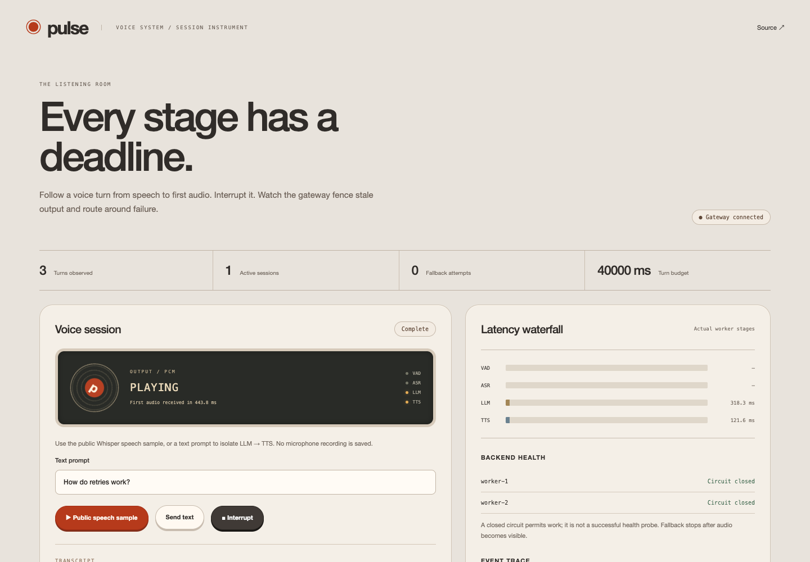
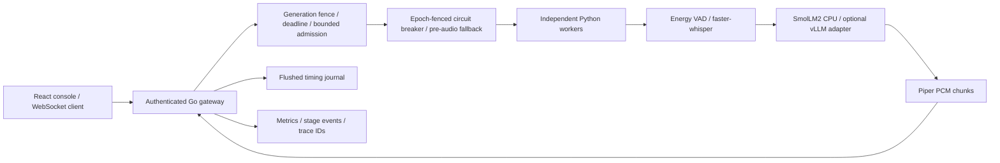

# Pulse

## Problem

Defend a voice turn's latency and cancellation boundary while real model workers stream, stall, fill their queues or crash.

**Status: partial.** [Public website and recorded demo](https://pulse-delta-ten-68.vercel.app) · [Repository](https://github.com/rjrddy/pulse) · [Quality checkpoint](docs/QUALITY.md). The Vercel site presents actual saved evidence; interactive model services are not hosted there.

## Results

| Proof | Measured result | Raw evidence |
|---|---|---|
| Local tests | 13 Go race-enabled tests and 4 Python tests passed | [required gate](docs/results/required-gates.log), [source hashes](docs/results/checks.json) |
| Configuration comparison at concurrency 4 | First-audio p99 1464.35 → 734.14 ms; 32 → 8 output-token cap; 8 samples per setting | [complete event traces](docs/results/model-bench.json) |
| Public-speech voice turns | 3 completed; first-audio range 714.96–761.98 ms | voice_rows in [campaign](docs/results/model-bench.json) |
| Real worker kill and interruption | Primary exited with signal result -9; secondary completed the following turn; replacement after interruption completed with no stale frames after acknowledgement | real_backend_kill and barge_in in [campaign](docs/results/model-bench.json) |
| Actual browser recording | 92.04 seconds | [video](docs/results/demo.webm), [ffprobe](docs/results/demo-probe.json), [browser events](docs/results/browser.json) |

Text → LLM → TTS through the Go WebSocket gateway:

| Output token cap | Concurrency | Samples | First token p50 / p99 ms | First audio p50 / p99 ms |
|---|---|---|---|---|
| 32 | 1 | 2 | 170.51 / 170.97 | 563.59 / 563.95 |
| 32 | 2 | 4 | 452.91 / 737.58 | 845.11 / 1123.35 |
| 32 | 4 | 8 | 550.97 / 924.14 | 1071.51 / 1464.35 |
| 8 | 1 | 2 | 171.31 / 171.87 | 295.74 / 298.55 |
| 8 | 2 | 4 | 318.41 / 476.03 | 445.88 / 596.97 |
| 8 | 4 | 8 | 367.43 / 575.24 | 533.16 / 734.14 |

The client clock starts immediately before sending a start frame on an established WebSocket. First token is the first nonempty decoded fragment; fragments are not necessarily tokenizer tokens. First audio means received PCM, before speaker playback. Text mode skips VAD/ASR. Small samples and interpolated quantiles are disclosed, not production capacity or an SLO. The shorter output cap changes answer length and inference/speech work; this is not an equal-quality optimization claim.

The real CPU models are faster-whisper tiny int8, SmolLM2 via Transformers, and Piper. [Environment and versions](docs/results/environment.json), [public model sources](docs/results/model-sources.json) and [saved dependency versions](requirements.lock) identify the setup. GPU and vLLM performance are **not measured**.

Caught failures are retained. The same [latency gate](scripts/budget_gate.py) rejects the longer-output setting against a configured budget and accepts the shorter one: [failing output](docs/results/budget-failure.json), [passing output](docs/results/budget-pass.json). [A real capacity-pressure failure](docs/results/caught-capacity-failure.log) exposed queue saturation being counted as poor backend health; a dedicated regression test now distinguishes those responses. CI also caught and retained a vulnerable base-image dependency, corrected before the passing checkpoint.

The domain experiment uses 3 Piper-generated glossary phrases: term accuracy 66.67% without hints / 100.00% with a fixed glossary; WER 26.67% / 0.00%. [Raw audio, references and transcriptions](docs/results/domain-eval.json) are a tiny development check, not held-out human-speech accuracy. [The cold-start lab](docs/results/cold-start.json) measures fresh worker processes with a warm filesystem/model cache; container start and restore remain **not measured**.



[Visual design references and UI checks](docs/UI.md) · [Redesigned console recording](docs/results/ui-redesign/demo.webm). Historical benchmark evidence remains separate.

## Architecture



## Run it

```sh
python3 scripts/configure.py
docker compose up --build
```

Open http://localhost:8081 and sign in using the password in your ignored .env. The stack downloads actual open models and prepares public sample audio. No paid API key is required. See [development](docs/DEVELOPMENT.md) for native runs, actual benchmark commands, optional observability and the vLLM adapter. See [demo steps](docs/DEMO.md) and the [interview guide](INTERVIEW.md).

## Decisions and limits

- [Design](docs/DESIGN.md), [ADRs](docs/adr), [migration provenance](docs/migration/pulse.md) and [rehearsal drill](docs/DRILL.md) explain code and boundaries.
- The local path accepts complete utterances and returns token previews and sentence audio chunks. Continuous microphone capture, streaming ASR endpointing and phoneme-level streaming TTS are unfinished.
- Fallback only precedes visible audio. Mid-speech failure ends the turn; the process-kill experiment tests a following turn, not seamless continuation of audible speech.
- Cancellation fences future gateway frames and stops queued browser audio. Native inference can continue until its current operation returns; its worker slot remains occupied.
- Circuit state, login limits and admission are per gateway process. No tenant isolation, distributed quota, cross-region failover or replicated journal is implemented.
- History stores only timing/IDs/outcomes. Its single-process journal fsyncs before final acknowledgement; a partial line blocks startup for explicit recovery. Stateless hosting needs an external persistence adapter.
- Stage event tracing and trace IDs are implemented; an OTLP exporter and long-term tracing backend are not. Prometheus/Grafana compose services are optional; full provisioned dashboard automation is unfinished.
- The public site hosts recorded evidence. Interactive hosted inference, a measured vLLM/GPU deployment, container start/restore and broad domain evaluation remain open. All original repos and the existing portfolio remain intact.

## Next

Deploy provisioned model services and durable external history. Add capture/endpointing, incremental TTS, capacity-aware batching, equal-quality latency comparisons, measured GPU/vLLM serving, container checkpoint/restore, broad voice-domain evaluation and tenant-scoped limits. Stop for review before Gatekeeper.
